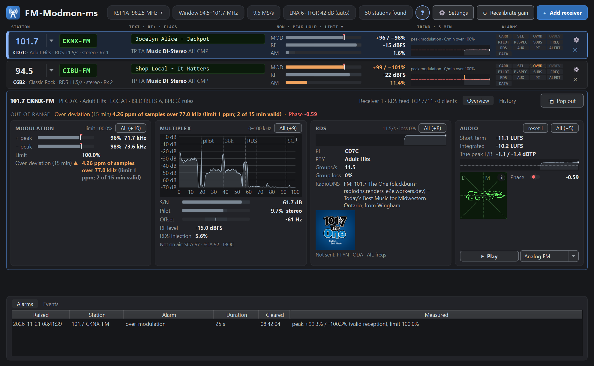
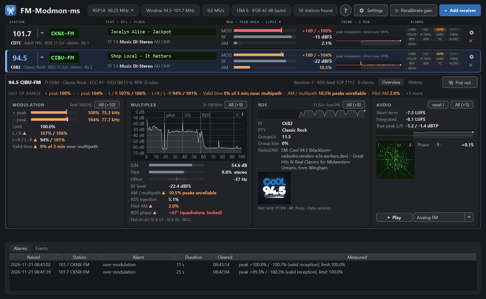
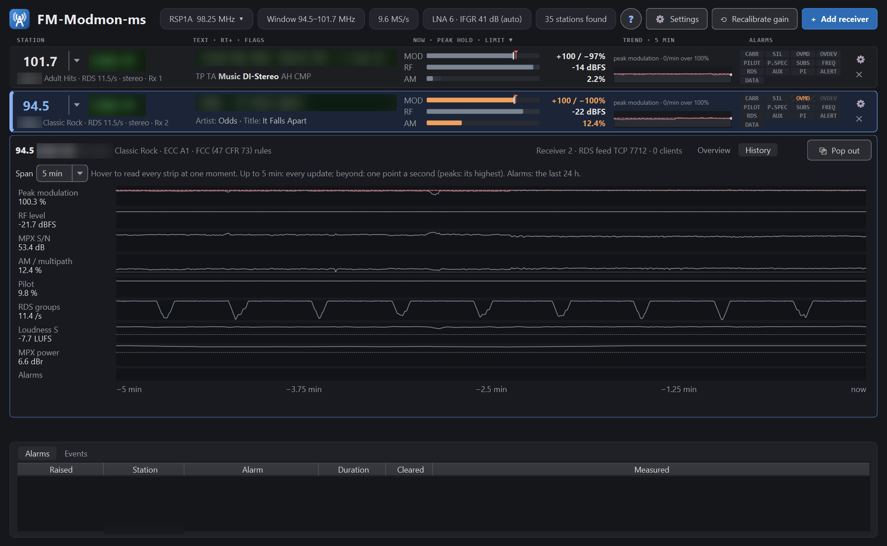

# FM-Modmon-ms

**Multi-station FM modulation monitor** for the SDRplay RSP1A, built on GNU Radio 3.10.
It also runs on an SDRplay RSP1B, an RTL-SDR or an Ettus B210 (see [SDRs](#sdrs)).

One RSP1A at 9.6 MS/s watches up to **four FM stations at once**: each gets its own
channel filter, stereo demodulator, RDS decoder, measurement chain, alarms and panel,
in a PyQt5 window and an identical web page with live audio.

## In use

Two stations off one RSP1A, 7.2 MHz apart: 101.7 and 94.5, called WEXA-FM and WEXB-FM here
(examples; their call letters and other identifying text are blurred):



A 1-minute demo, with each station's audio (music only): 101.7 in detail for 30 s, then 94.5 and its History
([download](docs/media/fm-modmon-ms-demo.mp4?raw=true)).

https://github.com/user-attachments/assets/2ee09cf4-8ef9-4e7f-abff-613bd7426aa1

| 94.5 in detail (multipath at this site, flagged amber) | 94.5's History tab |
|---|---|
|  |  |

## What it measures

Per station, refreshed 10× a second:

- **Modulation** – peak +/− (flagged when lopsided), peak deviation, over-100% / over-110%
  counts, the ITU-R SM.1268 over-deviation share over 15 minutes, the share of time
  reception was valid for peak readings, L, R, L+R, L−R, ITU-R BS.412 MPX power, and an
  MPX spectrum to 100 kHz
- **Signal** – RF level, MPX S/N, carrier offset, AM / multipath, synchronous AM, noise
  above 100 kHz, pilot level, frequency and AM, RDS injection and its phase against the
  pilot, SCA 67 / 92 kHz injection (and whether an SCA carries audio, data, a tone or
  nothing), and IBOC sideband level
- **Loudness** – ITU-R BS.1770 / EBU R128 momentary, short-term, integrated and true peak
- **Stereo image** – levels, balance, correlation, width and a goniometer
- **RDS** – PI, PS, RT, RT+ (Alarm tags in red), PTY / PTYN, flags, AF, ECC, ODA, CT,
  group rate and loss, group types
- **Data services** – the non-programme data a station carries and its share of groups:
  paging (7A, with the 1A paging codes, operator code and paging ID, and 13A enhanced
  paging), TMC (8A), EWS (9A), other ODAs and SCA data. Services are identified, never
  decoded. Each receiver can name them (e.g. `7A=Alert FM, SCA67=Muzak`).
- **IBOC** – via [nrsc5](https://github.com/theori-io/nrsc5): status, MER/BER, PSD, SIS,
  station logo and album art, emergency alerts
- **RadioDNS** – service information and slideshow (RadioVIS) slides, text and links over
  Server-sent Events, Stomp or HTTP long polling, tried in that order with SRV failover
  (ETSI TS 103 270 / TS 101 499 v3.2)

## The window

Normal readings are grey; amber means abnormal or not judged, red out of limits or an
alarm (ISA-101 high-performance HMI). Each station row has peak modulation against the
limit in force with a 2 s peak hold, RF and AM bars, a 5-minute sparkline and an
annunciator with every alarm in a fixed place (raised, holding off, not judged, off).
The detail view has Modulation (with a peak-distribution histogram), Multiplex, RDS and
Audio cards, listing what a station doesn't carry once instead of as dashes, and a History
tab: the readings as stacked strips over 1 minute to 1 hour with one cursor across them.
Under it, the Alarms tab lists each alarm once, with how long it lasted.

Each card shows its essential readings; "All" shows the rest (remembered, the same for every
receiver; the web page remembers its own choice per browser), and a hidden reading shows
anyway, marked ▲, while it is out of range, with one line above the cards listing everything
out of range (what doesn't fit is counted, "+n more"). Click any reading, bar, graph's (i) or alarm lamp, a station row's bars or
peak trend, or a History strip's name, for what it is, how it's measured, what it means
right now and the rule or standard behind it.

## Alarms

Carrier low/lost, audio silence, over-modulation, over-deviation over 15 minutes (ITU-R
SM.1268), pilot lost, RDS lost ("possibly on AUX"
instead when the carrier, pilot and audio stay fine, as the auxiliary/backup (AUX) transmitter
without an RDS encoder would cause), wrong PI, emergency alert (IBOC, or an RT+ Alarm tag), data service lost (a service on air for 5 minutes unbroken,
then unseen for 15 s, the alarm held 60 s; paging that only bursts during an alert never
alarms), and the FM technical rules of a preset (pilot out of tolerance, subcarriers over
the limit, carrier frequency out of tolerance), each limit adjustable per receiver:

| Check | FCC (47 CFR 73) | ISED (BETS-6, BPR-3) |
|---|---|---|
| Modulation | 100% + 0.5% per 1% subcarrier injection, max 110% | same, but the allowance only with two or more subcarriers on air (RDS alone: 100%) |
| Pilot | 8–10%, 19 kHz ± 2 Hz | same |
| Subcarriers | ≤ 20% total in stereo, 30% in mono; ≤ 10% above 75 kHz | ≤ 20% total in stereo or mono; ≤ 10% above 76 kHz |
| Carrier frequency | ± 2000 Hz | ± 1000 Hz |

Alarms go to the event log and optionally to email (SMTP) and webhooks (JSON, Slack,
Microsoft Teams, Discord). A watchdog reopens the SDR after a USB dropout, and warns of ADC
overload (wideband peaks at full scale, which make every receiver's readings false; the
stations' alarms are held until it clears).

## Antenna tuning

**Antenna tune** (at the top of the window or the web page) helps get the most from an antenna:
its length, position, direction, or which antenna to use. It holds the gain where it is and
measures each open station's S/N over the noise floor five times a second. The **score** is the
weakest station's S/N, because the monitor is only as good as its worst station. Each bar has a
tick at its best so far. Mark each setting you try (*dipole 75 cm*, *loop facing NE*) and the
marks are ranked by score. Watch each station's AM / multipath as well: a longer antenna can
pick up more reflections. Watch the ADC peaks too: too much signal overloads the SDR, and the
window says so. The web page can play a tone that rises a semitone for each dB of score, so you
can tune from a phone without looking at it. The receivers' alarms are held while tuning, and
recalibrating the gain waits until tuning stops.

## Recording

Off until you start it: click the **REC** chip at the top of the window (or tick it in
*Settings*), and click it again to stop; it stays as you left it across restarts. While on,
each receiver gets a line a minute in `records/fm-modmon-ms_<MHz>_YYYY-MM-DD.csv` (a file per
station and day, local time): the minute's peak modulation and AM as their maximum, the other
readings (RF, S/N, carrier offset, pilot, RDS, MPX power, loudness, correlation) as their
mean, and the alarms raised in that minute. The chip's menu opens the folder.

Event logs and records are kept until you set, in *Settings*, how many days to keep them; older
ones are then deleted at start and once a day (0, the default, keeps them all).

> The monitor is a measurement aid, not a type-approved modulation monitor. Carrier
> offset includes the SDR's own tuning error, and levels depend on gain calibration.

## Requirements

- **Windows 10/11** (developed and tested there; some parts – DNS SRV lookups for
  RadioDNS, sign-in autostart – use Windows APIs)
- **A 1080p screen or larger.** Each receiver is one row (station, text, modulation, RF
  and AM now, a 5-minute trend and every alarm), with the selected receiver in detail
  underneath: about 800 px tall with four receivers at 100% display scaling, so the whole
  window fits 1920 × 1080 without scrolling. Pop a receiver's detail out (or double-click
  its row) to watch several side by side on a larger screen.
- **SDRplay RSP1A** (or RSP1B) and the [SDRplay API](https://www.sdrplay.com/api/) 3.x, or
  another [supported SDR](#sdrs)
- **[radioconda](https://github.com/ryanvolz/radioconda)** (GNU Radio 3.10 with gr-rds,
  SoapySDR, NumPy, SciPy, PyQt5)
- **[SoapySDRPlay3](https://github.com/pothosware/SoapySDRPlay3)** built against radioconda's
  SoapySDR (radioconda can't ship it: the SDRplay API is closed source). Put the module in
  `../soapysdrplay3-build/modules` beside this folder, or set `SOAPY_SDR_PLUGIN_PATH`.
- Optional: **ffmpeg** on the PATH for web audio (MP3, AAC, Opus, FLAC)
- Optional: **nrsc5** on the PATH (or in a sibling `../nrsc5*/build/src/` folder) for IBOC

## Installing

In PowerShell (it asks for administrator rights):

```bash
irm https://raw.githubusercontent.com/RAEApps/FM-Modmon-ms/main/install.ps1 | iex
```

[`install.ps1`](install.ps1) installs the monitor and everything it needs, downloading each
piece from its source and skipping what's already installed:

- **radioconda** 2025.03.14 from its GitHub release (about 630 MB)
- **SDRplay API** (the RSP1A's USB driver and service): SDRplay only offers it from
  [its website](https://www.sdrplay.com/api/) after its licence, so setup opens that page and
  carries on once the download lands in Downloads; it must be signed by SDRplay
- **SoapySDRPlay3** and **nrsc5** from this repo's
  [`deps-2026.11` release](https://github.com/RAEApps/FM-Modmon-ms/releases/tag/deps-2026.11),
  and **ffmpeg** 8.0.1 from [gyan.dev's](https://github.com/GyanD/codexffmpeg) GitHub release
- **the monitor** from `main`, with Start menu and desktop shortcuts

Pinned downloads are checked against their SHA-256. At the end it asks for the RSP1A to be
plugged in and checks it's found. The monitor goes to `C:\Program Files\FM-Modmon-ms`; running
setup again updates it to the latest `main` and keeps its settings; anything else already
installed and current (checked by version or SHA-256) isn't downloaded again.

| Installed | Where |
|---|---|
| The monitor, SoapySDRPlay3, nrsc5, ffmpeg | `C:\Program Files\FM-Modmon-ms` |
| radioconda | `C:\ProgramData\radioconda` (its default for all users) |
| SDRplay API | `C:\Program Files\SDRplay` (its default) |

### Uninstalling

*Settings → Apps → Installed apps → FM-Modmon-ms → Uninstall*, or:

```bash
powershell -ExecutionPolicy Bypass -File "C:\Program Files\FM-Modmon-ms\install.ps1" -Uninstall
```

It asks for administrator rights, then removes the shortcuts (and the start-with-Windows one),
the monitor, SoapySDRPlay3, nrsc5 and ffmpeg, and asks whether to delete the settings and event
logs too (kept by default, for a later reinstall). radioconda and the SDRplay API stay
installed, as other SDR software may use them; remove them from *Settings → Apps* as
*radioconda* and *SDRplay API* (the latter also removes the RSP1A's driver).

## Running

```bash
C:\ProgramData\radioconda\python.exe fm-modmon-ms.py
```

The first start opens a short **setup**: where the monitor is (ISED rules in Canada, FCC
elsewhere), which SDR it uses, the web version and the password for its controls, email /
webhook notifications and starting with Windows. Run it again from *Settings → Run setup
again* or with `--setup`.

On start it scans 88–108 MHz, calibrates the SDR's gain for the stations found and opens a
receiver on the strongest. *Add receiver* opens more (any that fit in the SDR's window: 7.2 MHz
on the RSP1A).
Useful options:

```bash
C:\ProgramData\radioconda\python.exe fm-modmon-ms.py --freqs 94.5 101.7 --country US
```

| Option | |
|---|---|
| `--freqs MHZ …` | start on these stations instead of the saved ones |
| `--setup` | open the setup before starting |
| `--country CC` | ISO country (ISED rules for `CA`, FCC otherwise; RadioDNS) |
| `--sdr NAME` | `rsp1a`, `rsp1b`, `rtlsdr`, `b210` or a profiled SDR's key (must be plugged in), or `auto` (the default) |
| `--scan-sdrs` | list the radios plugged in (known, profiled here, new) and exit |
| `--profile-sdr SERIAL` | profile that radio and exit (the monitor must not be using it) |
| `--no-sdr-profile` | don't profile new SDRs at the start |
| `--lna N --ifgr DB` | SDRplay: fixed gain instead of start-up calibration |
| `--gain DB` | RTL-SDR or B210: fixed gain instead of start-up calibration |
| `--web-port N` | web version port (default 8765, `0` = off) |
| `--web-bind ADDR` | `127.0.0.1` keeps the web version on this PC |
| `--web-password PW` | web controls password, instead of the one set in setup |
| `--rds-port N` | first raw RDS group feed port (default 7711; `0` = off) |
| `--rds-bind ADDR` | `127.0.0.1` keeps the RDS feeds on this PC |
| `--web-audio FORMATS` | web audio formats to offer, first is the default (`mp3,aac,opus,flac`) |
| `--ffmpeg PATH` | ffmpeg for the web audio (default: on the PATH, or a WinGet install) |
| `--nrsc5 PATH` | nrsc5 executable for IBOC |
| `--no-radiodns` | no RadioDNS lookups |
| `--radiodns-client-id ID` | RadioDNS client identifier, for providers that need one |
| `--no-scan` | skip the band scan; the station lists then show every channel |
| `--config PATH` | where receivers and settings are saved |

Run with `--help` for details. Command-line options override what setup chose.
Receivers and settings are saved to `fm-modmon-ms_config.json`; events are logged to `logs/`,
measurements (when [recording](#recording)) to `records/`.

### Passwords

- **Web password** – kept in the settings file only as a salted PBKDF2-SHA256 hash.
- **SMTP password** – it has to be sent as is, so it is kept in **Windows Credential Manager**
  (entry `FM-Modmon-ms/smtp`, protected by your Windows sign-in), never in the settings file.

### Environment variables

| Variable | Use |
|---|---|
| `FM_MODMON_WEB_PASSWORD` | web controls password, instead of the one set in setup |
| `FM_MODMON_SMTP_PASSWORD` | SMTP password, instead of the one in Credential Manager |
| `RADIODNS_CLIENT_ID` | RadioDNS client identifier, for providers that need one |
| `SOAPY_SDR_PLUGIN_PATH` | where the SoapySDRPlay3 module is |

## SDRs

At each start the monitor looks for every radio plugged in (anything SoapySDR finds, sound
cards aside) and identifies each by its driver and serial. It uses the one with the widest
window (B210, then RSP1A / RSP1B, then RTL-SDR, profiled ones by their own window). The event
log says which it found. *Settings* (or setup) can name a preferred SDR, used when it's plugged
in, from the next start; `--sdr` names one that must be. To change SDR while running, click the
SDR chip at the top of the window (▾) and pick another one plugged in: the monitor restarts on
it (about half a minute), scans, calibrates its gain and reopens the receivers that fit its
window; it also becomes the preferred SDR.

### New SDRs

A radio none of the built-in profiles below fits (another SDRplay model, an Airspy HF+, a
HackRF, a LimeSDR…) is **profiled** the first time the monitor starts with it plugged in: a
dialog shows the steps, about two minutes, and *Skip* leaves it for later. Each step runs in a
short-lived helper process, as a radio not yet profiled may crash as it closes:

1. what SoapySDR says it can do (it must tune 87.5–108 MHz and have a gain control);
2. the fastest sample rate, a whole multiple of 384 kS/s (2.304 to 30.72 MS/s), that streams
   without overflows, stalls or lost samples, for 3 s and then 8 s;
3. a starting gain (the band scan's; the gain is calibrated at each start as usual);
4. how far either side of the centre its filter is flat (within 1 dB): that sets how far apart
   stations can be and the band-scan windows;
5. whether it closes cleanly (five times): if not, it is never closed while the monitor runs,
   as the B210 isn't;
6. the CPU one receiver takes on it;
7. the profile checked as the built-in ones are.

The profile is saved in the settings file (`sdrs`), and the radio is then one of the SDRs to
use, prefer and switch to. One that can't be used (for example an Airspy R2, whose 10 and
2.5 MS/s aren't multiples of 384 kS/s) or whose profiling failed is listed with the reason, and
isn't profiled again at each start. The SDR chip offers new radios for profiling and *Look for
SDRs plugged in since*, which finds radios plugged in while running. *Settings → SDRs* lists every
radio, plugged in or profiled here, with its profile: *Profile…* (again), *Report…* (what
profiling found) and *Forget*. `--scan-sdrs` and `--profile-sdr SERIAL` do the same from the
command line; `--profile-sdr` on a built-in kind prints its measured profile beside the
built-in one without saving it.

All the stations come from one SDR window, so the SDR's sample rate sets how far apart they can
be. Every station is filtered down to the same 384 kS/s, so the measurements are the same
whichever SDR it is.

| SDR | `--sdr` | Rate | Stations within | Gain | Needs |
|---|---|---|---|---|---|
| SDRplay RSP1A | `rsp1a` | 9.6 MS/s | 7.2 MHz | `--lna`, `--ifgr` | SDRplay API, SoapySDRPlay3 |
| SDRplay RSP1B | `rsp1b` | 9.6 MS/s | 7.2 MHz | `--lna`, `--ifgr` | the same; SDRplay API 3.15 or later, and a SoapySDRPlay3 that knows the RSP1B |
| RTL-SDR | `rtlsdr` | 2.304 MS/s | 1.4 MHz | `--gain` 0–49.6 dB | the WinUSB driver (install it with [Zadig](https://zadig.akeo.ie/)); radioconda has the SoapySDR module |
| Ettus B210 (and clones) | `b210` | 30.72 MS/s | the whole band (88.1–107.9 MHz) | `--gain` 0–76 dB | a USB 3 port; the WinUSB driver ([Zadig](https://zadig.akeo.ie/): *WestBridge*, 2500 0020); UHD's FPGA images in `%LOCALAPPDATA%\uhd\images` (`uhd_images_downloader -t "b2xx_b210_fpga\|b2xx_common_fw" -i %LOCALAPPDATA%\uhd\images`, or set `UHD_IMAGES_DIR`); radioconda has UHD and the SoapySDR module |

The B210 takes in the whole band at 30.72 MS/s: any four stations can be open at once,
and the band scan is one capture. Its receivers' channel filters cost about three times
an RSP1A's CPU (four receivers took 1.7 cores on a 20-thread PC). Put an **FM band-pass
filter** (88–108 MHz) or a ~110 MHz low-pass in front of it: unlike the RSP1A, it has no
filtering of its own ahead of the mixer, which also mixes on odd harmonics of its tuning.
Centred on 98 MHz, a cellular carrier near 886 MHz (9 × 98 = 882 MHz) came in as a 4 MHz
block of noise 16 dB above the floor across 102–105 MHz, and the scan listed every channel
there as a station.

UHD (4.8, on Windows) can crash closing a B210, so the monitor never closes it while it
runs: the start-up scan and gain calibration run in a short-lived helper process, the monitor
exits without closing it (Windows releases it), and when the B210 goes silent the monitor
restarts itself on it instead of reopening it in place (about half a minute; it waits for the
B210 to come back, and after a minute uses another SDR if one is plugged in).

An RTL-SDR's 8-bit ADC has much less headroom than the others, and its window takes only
stations within 1.4 MHz of each other, often just one or two. Saved receivers that don't
fit the window are left closed. On an RTL-SDR without a TCXO, the frequency error shows up
as carrier offset.

## Web version

`http://<this-pc>:8765/` shows the same station rows and detail (without the History tab),
drawn from the same readings and updated 10× a second, with each receiver's audio in the
browser. Anyone who can reach the port can watch and listen; the controls
need the web password (set in setup), or, without one, a browser on the monitor PC itself.

**Security:** the web version is plain HTTP, so the password crosses the network
unencrypted. Use it on a trusted network, bind it to `127.0.0.1` behind a TLS reverse
proxy, or reach it over a VPN. Don't expose it directly to the internet.

## RDS group feed

Each receiver serves its error-free RDS groups over TCP (by default ports 7711–7714 for
receivers 1–4; each receiver's port can be changed or the feed turned off in its settings) as
hex text, one group per line – the format of an Inovonics INOmini 633 or RDS Spy – for other
RDS software.

## Tests

The tests drive the real receiver chain with a synthetic FM transmitter (`tests/fmtx.py`:
stereo, pilot, RDS per IEC 62106, SCA, AM, noise, carrier offset) and check the readouts
and alarms against known values. No SDR is needed.

```bash
C:\ProgramData\radioconda\python.exe tests\verify_meas.py
```

```bash
C:\ProgramData\radioconda\python.exe tests\rules_test.py
```

`tests\setup_test.py` checks the setup wizard, the password hash, Credential Manager and
the web sign-in. `tests\radiovis_test.py` checks the RadioDNS slideshow (SSE, HTTP and
Stomp, SRV failover, trigger times, bad slides) against local fake servers.
`tests\centre_test.py` checks where the RSP1A centres: no carrier on its DC offset or on
another station's IQ image, and none past the IF filter's usable edge.
`tests\record_test.py` checks the recording (a line a minute, the REC chip) and the deletion of
old event logs and records.
`tests\notify_test.py` checks email and webhook notifications against local fake servers
(batching, retries, the test message). `tests\web_test.py` checks the web version's pages,
sign-in, sessions and controls. `tests\recovery_test.py` checks what happens when the SDR is
lost: reopening it, and restarting on a B210.
`tests\antenna_test.py` checks antenna tuning: the S/N readings on a synthetic band, the score,
peak hold and marks, and the live measurement surviving the SDR being reopened.
`tests\sdr_test.py` checks each SDR's rate, window and scan, how `--sdr` and the setup
pick it, and a synthetic station through a receiver at each SDR's sample rate.
`tests\inventory_test.py` checks how the radios found are classified, the profiler on a
simulated radio (its rate, filter, gain, closes; radios it can't use), and learned profiles
saved, chosen and forgotten.

## CPU profile

`tools\profile_cpu.py` shows where the monitor's CPU goes on the real RSP1A: the GUI
thread, the Python meters, GNU Radio's C++ blocks, and the rest (mostly a thread per
block waking and passing buffers). Close the monitor first, then run it from the app
folder (the installer puts it in `app\tools`):

```bash
C:\ProgramData\radioconda\python.exe tools\profile_cpu.py
```

It runs the monitor with the saved receivers for about 70 s, prints the report and
saves it as `fm-modmon-profile.txt` on the Desktop. Arguments after the script name go
to the monitor, such as `--freqs 94.5 101.7`.

## Examples

`examples/` has the simple single-station GNU Radio Companion flowgraphs this started from
(RSP1A and simulated).

## License

GPL-3.0-or-later – see [LICENSE](LICENSE). GNU Radio, gr-rds and PyQt5 are GPL-licensed too.
